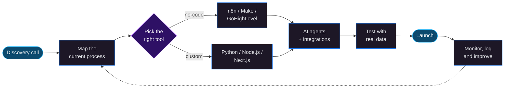
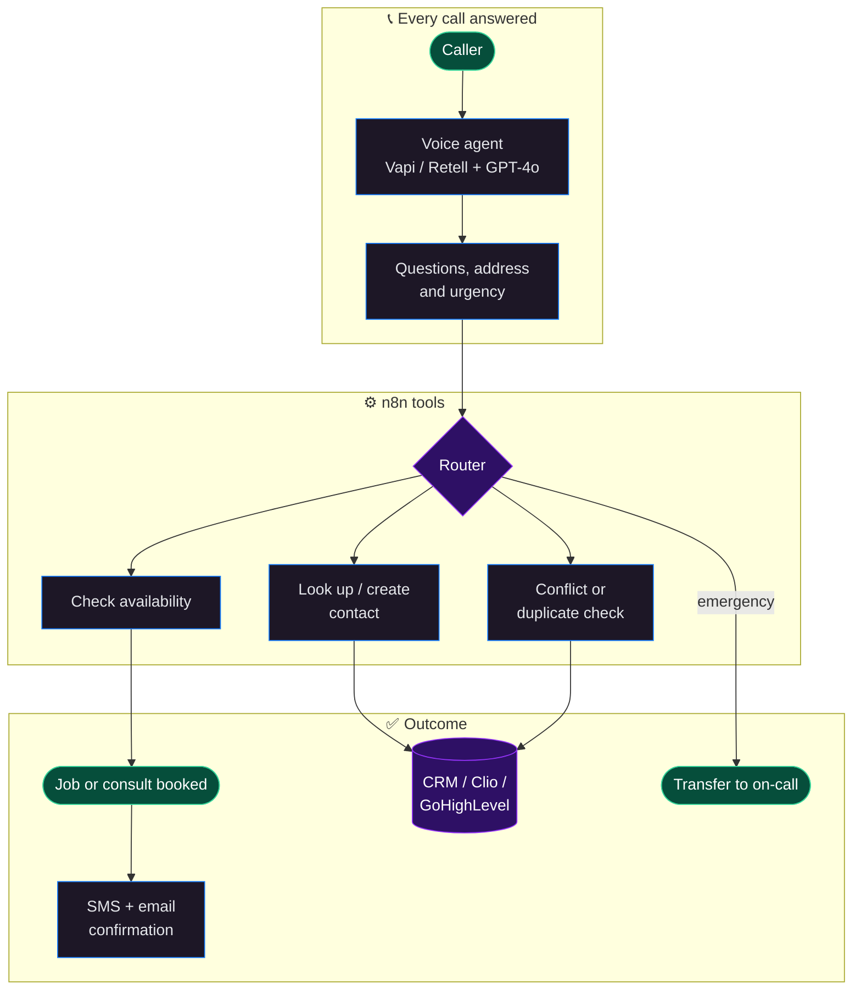

<!-- ═══════════════════════════════ HEADER ═══════════════════════════════ -->

<div align="center">


<a href="https://github.com/samiullah156-creator">
  
</a>

<br/>

<!-- ─────────────── SOCIAL BADGES ─────────────── -->
<p>
  <a href="https://lexvaxa.com"></a>
  <a href="https://www.linkedin.com/in/sami-lexvaxa/"></a>
  <a href="mailto:info@lexvaxa.com"></a>
</p>

<p>
  
  
  
  
</p>

</div>


<!-- ═══════════════════════════════ AT A GLANCE ═══════════════════════════════ -->

<div align="center">

<table>
<tr>
<td align="center" width="20%">
  <br/>
  <b>60+</b><br/><sub>Public Repos</sub>
</td>
<td align="center" width="20%">
  <br/>
  <b>40+</b><br/><sub>Project Case Studies</sub>
</td>
<td align="center" width="20%">
  <br/>
  <b>4</b><br/><sub>Automation Platforms</sub>
</td>
<td align="center" width="20%">
  <br/>
  <b>6</b><br/><sub>Industries Served</sub>
</td>
<td align="center" width="20%">
  <br/>
  <b>Microsoft</b><br/><sub>Certified AI/ML Engineer</sub>
</td>
</tr>
</table>

</div>

---

<!-- ═══════════════════════════════ ABOUT ═══════════════════════════════ -->

##  &nbsp;About Me


```python
class SamiChaudhary:
    def __init__(self):
        self.role       = "AI Engineer | Automation Architect"
        self.company    = "Founder, Lexvaxa"
        self.builds     = ["AI Agents", "Voice Receptionists",
                           "RAG Assistants", "Workflow Automation",
                           "SaaS & Dashboards"]
        self.platforms  = ["n8n", "Make.com", "Zapier", "GoHighLevel"]
        self.industries = ["Legal", "Healthcare", "Home Services",
                           "E-commerce", "Finance", "Marketing"]

    def how_i_work(self):
        return ("Map the process -> Automate the busy work "
                "-> Test with real data -> Launch -> Improve")
```

> I'm **Sami Chaudhary**, founder and AI engineer at **[Lexvaxa](https://lexvaxa.com)**. I help law firms,
> clinics, home-service companies, agencies and e-commerce brands replace manual work with
> AI agents, automations and custom software that plug into the tools they already use.

- 🤖 &nbsp;Building **AI voice receptionists**, **multi-agent systems** and **RAG assistants**
- ⚖️ &nbsp;Legal tech: **Clio**, **Filevine** and **RingCentral** intake, case and billing automation
- ⚙️ &nbsp;Automation on **n8n**, **Make.com**, **Zapier** and **GoHighLevel**, connected to CRMs, Shopify, Airtable and WhatsApp
- 👁️ &nbsp;Computer vision: **crop disease detection** and **driver drowsiness detection**
- 💻 &nbsp;SaaS products and dashboards with **Next.js**, **React**, **Node.js**, **Python** and **MongoDB**
- 💬 &nbsp;Ask me about **AI agents, voice AI, n8n, CRM automation and legal-tech workflows**

<br clear="right"/>

---

<!-- ═══════════════════════════════ PROCESS ═══════════════════════════════ -->

##  &nbsp;How I Build Automations



---

<!-- ═══════════════════════════════ FEATURED ═══════════════════════════════ -->

##  &nbsp;Featured Projects

<table>
<tr>
<td width="50%" valign="top">

### 📞 [AI Voice Receptionist for HVAC](https://github.com/samiullah156-creator/hvac-ai-voice-receptionist)
An AI voice agent that answers every call, qualifies the lead and books the job.

- Collects the issue and verifies the service address
- Checks technician availability and books automatically
- Handles cancellations and flags emergencies
- Logs every lead to the CRM


</td>
<td width="50%" valign="top">

### ⚖️ [Clio Legal Intake & Matter Automation](https://github.com/samiullah156-creator/clio-legal-intake-automation)
An AI agent qualifies every inquiry and opens the matter in Clio with no data entry.

- AI qualification and case-detail extraction
- Conflict check against existing Clio contacts
- Contact, matter, tasks and consultation created
- Welcome email to the client, alert to the attorney


</td>
</tr>
<tr>
<td width="50%" valign="top">

### 🧠 [Multi-Agent AI System in n8n](https://github.com/samiullah156-creator/multi-agent-ai-system-n8n)
A central AI agent that routes each request to the right specialist agent.

- Email, Drive, content, social, contacts and calendar agents
- Web research and conditional routing
- New agents added without rebuilding the workflow
- Logging and clear errors on every run


</td>
<td width="50%" valign="top">

### 💬 [WhatsApp AI Chatbot](https://github.com/samiullah156-creator/whatsapp-ai-chatbot)
A modular AI chatbot for WhatsApp, Facebook and Instagram conversations.

- Multi-channel message handling and routing
- Specialist AI agents and sub-agents
- MCP tool connections, webhooks and APIs
- Grows without rebuilding the whole workflow


</td>
</tr>
<tr>
<td width="50%" valign="top">

### 🌱 [Cotton Care AI](https://github.com/samiullah156-creator/Cotton-Care-AI)
Detects cotton leaf diseases from a photo and recommends treatment.

- TensorFlow CNN served by a Flask API
- Gemini + Genkit flows for treatment advice
- Pesticide shop with an admin product form
- Next.js frontend with auth and route guards


</td>
<td width="50%" valign="top">

### 🚗 [Driver Drowsiness Detection](https://github.com/samiullah156-creator/Driver-Drowsiness-Detection-System)
Real-time computer vision that warns a driver before they fall asleep.

- Eye-aspect-ratio blink tracking with dlib
- Alarm when the eyes stay closed too long
- Lane detection module
- Streamlit web app (installable PWA)


</td>
</tr>
</table>

---

<!-- ═══════════════════════════════ ARCHITECTURE ═══════════════════════════════ -->

##  &nbsp;An AI Receptionist I Ship



---

<!-- ═══════════════════════════════ ALL WORK ═══════════════════════════════ -->

##  &nbsp;All Projects

<details>
<summary><b>⚖️ Legal tech (9)</b></summary>
<br/>

| Project | What it does |
|:--|:--|
| [AI Legal Intake & Law Firm Automation](https://github.com/samiullah156-creator/ai-legal-intake-automation) | AI agents take client intake, check cases and route matters |
| [Clio Legal Intake & Matter Automation](https://github.com/samiullah156-creator/clio-legal-intake-automation) | Qualified inquiries become Clio contacts and matters |
| [Filevine Case Status & Deadline Automation](https://github.com/samiullah156-creator/filevine-case-status-automation) | Filevine phase changes trigger client updates and deadlines |
| [RingCentral Call Logging & Text-Back](https://github.com/samiullah156-creator/ringcentral-call-logging-text-back) | AI call summaries logged to the CRM, missed calls texted back |
| [Medical Records Intake for PI Firms](https://github.com/samiullah156-creator/pi-medical-records-intake) | Consent checks, records requests and an audit log |
| [CaseFlow: Intake & Case Pipeline](https://github.com/samiullah156-creator/law-firm-intake-case-pipeline) | Every lead tracked from first contact to signed client |
| [Docketly: Workload & Deadline Calendar](https://github.com/samiullah156-creator/attorney-workload-deadline-calendar) | Attorney capacity next to hearings and deadlines |
| [LedgerLaw: Billing & Collections](https://github.com/samiullah156-creator/law-firm-billing-collections-dashboard) | Billed vs collected, aging and realization |
| [Law Firm CRM & Client Portal](https://github.com/samiullah156-creator/law-firm-crm-client-portal) | A custom CRM built around intake and case work |

</details>

<details>
<summary><b>🤖 AI agents & automation (14)</b></summary>
<br/>

| Project | Platform |
|:--|:--|
| [AI Voice Receptionist for HVAC](https://github.com/samiullah156-creator/hvac-ai-voice-receptionist) | n8n · Vapi · GPT-4o |
| [Multi-Agent AI System](https://github.com/samiullah156-creator/multi-agent-ai-system-n8n) | n8n |
| [AI Appointment Booking Agent](https://github.com/samiullah156-creator/ai-appointment-booking-agent) | n8n · OpenAI |
| [WhatsApp AI Chatbot](https://github.com/samiullah156-creator/whatsapp-ai-chatbot) | n8n · WhatsApp API |
| [AI Legal Chatbot with RAG](https://github.com/samiullah156-creator/AI-Powered-Legal-Chatbot-with-RAG-Workflow-Automation) | n8n · OpenAI · Supabase |
| [AI CRM Assistant](https://github.com/samiullah156-creator/ai-crm-assistant-airtable) | OpenAI · Airtable |
| [AI ROI Analysis with Claude](https://github.com/samiullah156-creator/ai-roi-analysis-claude) | n8n · Claude |
| [AI Event Follow-Up Outreach](https://github.com/samiullah156-creator/ai-event-follow-up-outreach) | n8n · HubSpot |
| [Google Maps Lead Generation](https://github.com/samiullah156-creator/google-maps-lead-generation-crm) | n8n |
| [AI Social Media Automation](https://github.com/samiullah156-creator/ai-social-media-automation) | n8n · Claude · Airtable |
| [AI Blog to WordPress](https://github.com/samiullah156-creator/ai-blog-wordpress-automation) | n8n · WordPress |
| [Shopify AI Agent](https://github.com/samiullah156-creator/shopify-ai-agent-automation) | n8n · Shopify |
| [Shopify Workflow Automation](https://github.com/samiullah156-creator/shopify-workflow-automation-make) | Make.com |
| [Website & Live Chat Tracking](https://github.com/samiullah156-creator/website-live-chat-tracking-make) | Make.com |

</details>

<details>
<summary><b>📈 GoHighLevel (4)</b></summary>
<br/>

[Law Firm Website & CRM](https://github.com/samiullah156-creator/ghl-law-firm-website-crm) · [Dental Lead Funnel](https://github.com/samiullah156-creator/ghl-dental-lead-funnel) · [Agency Website](https://github.com/samiullah156-creator/ghl-digital-marketing-agency-website) · [GHL & NMI Billing Automation](https://github.com/samiullah156-creator/ghl-nmi-billing-automation)

</details>

<details>
<summary><b>📊 Dashboards (4)</b></summary>
<br/>

[Clinic Patient Flow](https://github.com/samiullah156-creator/clinic-patient-flow-dashboard) · [StockPilot: Sales & Inventory](https://github.com/samiullah156-creator/store-sales-inventory-dashboard) · [FieldDesk: Dispatch Board](https://github.com/samiullah156-creator/field-service-dispatch-board) · [LeadLens: Marketing ROI](https://github.com/samiullah156-creator/legal-marketing-roi-dashboard)

</details>

<details>
<summary><b>🧪 AI / ML & full-stack apps (12)</b></summary>
<br/>

| Project | Stack |
|:--|:--|
| [Cotton Care AI](https://github.com/samiullah156-creator/Cotton-Care-AI) + [Backend](https://github.com/samiullah156-creator/Cotton-Care-AI-Backend) | Next.js · TensorFlow · Flask · Gemini |
| [Driver Drowsiness Detection](https://github.com/samiullah156-creator/Driver-Drowsiness-Detection-System) | Python · OpenCV · dlib · Streamlit |
| [Anomaly Detection Studio](https://github.com/samiullah156-creator/Anomaly-Detection-Studio) | Flask · scikit-learn · XGBoost |
| [Life Care Health Monitoring](https://github.com/samiullah156-creator/Life-Care-Health-Monitoring-System) | React · Firebase |
| [Education Management System](https://github.com/samiullah156-creator/Education-Management-Tracking-System) | MERN · Gemini |
| [Shah AI: Creative Coding Chatbot](https://github.com/samiullah156-creator/Shah-AI-Creative-Coding-Chatbot) | React · Gemini |
| [Financial DDR for Real Estate](https://github.com/samiullah156-creator/financial-ddr-real-estate) | React · TypeScript · Gemini |
| [SAFF Hospital Management](https://github.com/samiullah156-creator/saff-hospital-management-system) | React · TypeScript |
| [Android Security Forensics](https://github.com/samiullah156-creator/Android-Security-Forensics-Evaluation) | Next.js · TypeScript |
| [AI E-commerce Store](https://github.com/samiullah156-creator/ai-ecommerce-store) | React · TypeScript |
| [Lexvaxa Website](https://github.com/samiullah156-creator/lexvaxa-website) | Next.js 16 · TypeScript |

</details>

<details>
<summary><b>🌐 Websites, products & blueprints (18)</b></summary>
<br/>

[ControlBuddy](https://github.com/samiullah156-creator/controlbuddy) · [Custom Canvas](https://github.com/samiullah156-creator/custom-canvas) · [Wealthy Fitness](https://github.com/samiullah156-creator/wealthy-fitness) · [The Learning Hub](https://github.com/samiullah156-creator/learning-hub) · [GenAIX](https://github.com/samiullah156-creator/genaix) · [EXECT Services](https://github.com/samiullah156-creator/exect-services) · [Exect Media Kit](https://github.com/samiullah156-creator/exect-media-kit) · [Magic Wal Kit](https://github.com/samiullah156-creator/magic-wal-kit) · [Compo Capital Advisors](https://github.com/samiullah156-creator/compo-capital-advisors-website) · [E-Commerce React Store](https://github.com/samiullah156-creator/E-Commerce-React-Store) · [Business Website](https://github.com/samiullah156-creator/Business-Website-React) · [Traveler Website](https://github.com/samiullah156-creator/Traveler-Website) · [Car Collection](https://github.com/samiullah156-creator/Car-Collection-Website) · [Movie Streaming UI](https://github.com/samiullah156-creator/Movie-Streaming-UI) · [Food Website](https://github.com/samiullah156-creator/Food-Website)

**Solution blueprints:** [Company Knowledge Assistant](https://github.com/samiullah156-creator/company-knowledge-assistant) · [Invoice Processing](https://github.com/samiullah156-creator/invoice-processing-automation) · [Lead & CRM Automation](https://github.com/samiullah156-creator/lead-crm-automation)

</details>

> Client case studies describe the problem, the solution and the results. Client code, data and credentials stay private, and screens use sample data.

---

<!-- ═══════════════════════════════ TECH STACK ═══════════════════════════════ -->

##  &nbsp;Tech Stack

<div align="center">

<a href="https://skillicons.dev">
  
</a>

<br/><br/>

#### 🤖 &nbsp;AI, LLMs & Agents


#### ⚙️ &nbsp;Automation & CRM


#### 🧪 &nbsp;Machine Learning & Computer Vision


</div>

---

<!-- ═══════════════════════════════ STATS ═══════════════════════════════ -->

##  &nbsp;GitHub Analytics

<div align="center">


</div>

---

<!-- ═══════════════════════════════ CONTACT ═══════════════════════════════ -->

##  &nbsp;Let's Build Something

<div align="center">

**Need an AI agent, an automation or a custom app? Let's talk.**

<a href="https://lexvaxa.com/contact"></a>
<a href="mailto:info@lexvaxa.com"></a>
<a href="https://www.linkedin.com/in/sami-lexvaxa/"></a>

<br/><br/>

> *"Automate the busy work, so people can do the work that matters."*

<br/>

⭐️ &nbsp;From [**@samiullah156-creator**](https://github.com/samiullah156-creator) · thanks for stopping by!

</div>


